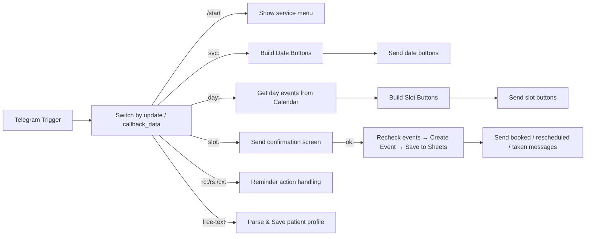

# Clinic booking bot

One-line summary: Telegram bot for booking clinic visits, built on self-hosted n8n with Google Calendar, Google Sheets and n8n Data Tables. No paid APIs.

## Problem

Phone-only booking, manual reminders and lost cancellations create friction for patients and overhead for clinic staff. This project provides an automated Telegram booking flow backed by Google Calendar and Google Sheets, and a reminder workflow to reduce no-shows.

## Features

- Patient profile: surname, name, date of birth with validation
- Service and day selection
- Free slots from Google Calendar based on service duration
- Slot re-check just before booking
- Double-tap protection (detects repeated confirm taps)
- 24h and 2h reminders with confirm / reschedule / cancel buttons
- Safe rescheduling: old event deleted only after the new one is created
- Clinic rule: changes less than 2 hours before the visit allowed only by phone
- Admin notifications for cancellations and reschedules

## Architecture

Two workflows:

- Clinic Router: Telegram Trigger → Switch (routes by callback_data prefixes svc:, day:, slot:, ok:, rc:, rs:, cx:) and handles free-text profile input
- Clinic Reminders: Schedule Trigger (every 15 minutes) → read Sheet → send 24h / 2h reminders (updates reminded_24h / reminded_2h flags)

Mermaid flowcharts

Clinic Router



Clinic Reminders

```mermaid
flowchart LR
    A[Schedule Trigger (every 15 min)] --> B[Read bookings from Google Sheets]
    B --> C[Filter confirmed bookings and compute 24h/2h reminders]
    C -->|24h| D[Send 24h Reminder + buttons]
    C -->|2h| E[Send 2h Reminder]
    D --> F[Mark reminded_24h]
    E --> F[Mark reminded_2h]
```

## Data model

Google Sheets (bookings) columns:

booking_id, chat_id, patient_name, service, start, end, status, event_id, reminded_24h, reminded_2h, attended, created_at, reschedule_pending, birth_date, visit_date, visit_time

n8n Data Table (clinic_patients): chat_id, last_name, first_name, middle_name, birth_date

## Setup

1. Import the two workflow JSON files into n8n.
2. Create n8n credentials:
   - Telegram Bot API (set bot token in credential or as environment variable)
   - Google Calendar OAuth2
   - Google Sheets OAuth2
   - n8n Data Tables (clinic_patients)
3. Replace all placeholders in the workflows and in .env with actual values (see .env.example).
4. Create the Google Sheet with headers listed above.
5. Set both workflows' timezone to Europe/Kyiv.
6. Activate the Clinic Router workflow first, then the Clinic Reminders workflow.

## Engineering notes

- One webhook per Telegram bot: reminder buttons are routed to the Router workflow because they all arrive via the same bot webhook.
- Availability is checked twice: once when listing free slots (fast local filter vs calendar events) and again immediately before booking to avoid race conditions.
- Rescheduling keeps the old booking marked pending and only deletes the old calendar event after the new one is created, preventing accidental loss of booking.
- Regexes avoid using `\b` because it breaks on Cyrillic.

## Roadmap

- Admin "Did the patient come?" post-visit poll
- Weekly no-show report

## Screenshots

Place screenshots in docs/screenshots/ named:

- 01-sheet-empty.png
- 02-service-menu.png
- 03-date-picker.png
- 04-slot-picker.png
- 05-confirm.png
- 06-reminder.png

Loom demo: <insert Loom link here>

## Data privacy

All data in screenshots and examples is fictional.
