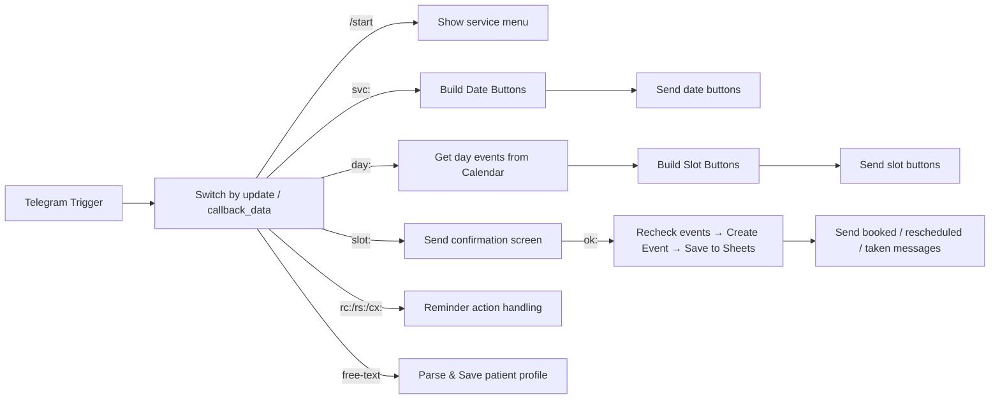

# Clinic booking bot

Одна коротка строка: Telegram-бот для запису на візити до клініки, побудований на самохостингу n8n з Google Calendar, Google Sheets та n8n Data Tables. Без платних API.

## Проблема

Запис тільки по телефону, ручні нагадування і пропущені скасування створюють навантаження на персонал і незручності для пацієнтів. Цей проєкт автоматизує запис через Telegram з календарною інтеграцією і системою нагадувань.

## Функції

- Профіль пацієнта: прізвище, ім'я, дата народження з валідацією
- Вибір послуги та дати
- Вільні слоти з Google Calendar з урахуванням тривалості послуги
- Повторна перевірка доступності безпосередньо перед бронюванням
- Захист від подвійного натискання підтвердження
- Нагадування за 24 години і за 2 години з кнопками підтвердити / перенести / скасувати
- Безпечне перенесення: стара подія видаляється лише після створення нової
- Правило клініки: зміни менш ніж за 2 години — тільки по телефону
- Повідомлення адміну про скасування і перенесення

## Архітектура

Два робочі потоки:

- Clinic Router: Telegram Trigger → Switch (маршрутизація за callback_data префіксами svc:, day:, slot:, ok:, rc:, rs:, cx:) і розбір вільного тексту для профілю
- Clinic Reminders: Schedule Trigger (кожні 15 хв) → читання з Sheets → відправка нагадувань 24h / 2h (позначки reminded_24h / reminded_2h)

Mermaid-діаграми

Clinic Router



Clinic Reminders

```mermaid
flowchart LR
    A[Schedule Trigger (every 15 min)] --> B[Read bookings from Google Sheets]
    B --> C[Filter confirmed bookings and compute 24h/2h reminders]
    C -->|24h| D[Send 24h Reminder + buttons]
    C -->|2h| E[Send 2h Reminder]
    D --> F[Mark reminded_24h]
    E --> F[Mark reminded_2h]
```

## Модель даних

Google Sheets (bookings) стовпці:

booking_id, chat_id, patient_name, service, start, end, status, event_id, reminded_24h, reminded_2h, attended, created_at, reschedule_pending, birth_date, visit_date, visit_time

n8n Data Table (clinic_patients): chat_id, last_name, first_name, middle_name, birth_date

## Налаштування

1. Імпортуйте два JSON-файли робочих потоків в n8n.
2. Створіть облікові дані в n8n:
   - Telegram Bot API (встановіть токен бота в облікових даних або як змінну середовища)
   - Google Calendar OAuth2
   - Google Sheets OAuth2
   - n8n Data Tables (clinic_patients)
3. Замініть усі заповнювачі у робочих потоках і в .env на реальні значення (див. .env.example).
4. Створіть Google Sheet з заголовками, вказаними вище.
5. Встановіть часовий пояс обох робочих потоків на Europe/Kyiv.
6. Активуйте спочатку Clinic Router, потім Clinic Reminders.

## Інженерні нотатки

- Один webhook на бота Telegram: кнопки нагадувань обробляються Router, бо всі запити надходять через той самий webhook.
- Доступність перевіряється двічі: на списку слотів і безпосередньо перед бронюванням, щоб уникнути гонки.
- При перенесенні стара бронь помічається як pending і стара подія видаляється лише після створення нової.
- Регулярні вирази уникають `\b`, бо це ламає роботу з кирилицею.

## План розвитку

- Адмін-опитування "Хворий прийшов?" після візиту
- Щотижневий звіт по no-show

## Скриншоти

Розмістіть файли у docs/screenshots/:

- 01-sheet-empty.png
- 02-service-menu.png
- 03-date-picker.png
- 04-slot-picker.png
- 05-confirm.png
- 06-reminder.png

Loom демо: <insert Loom link here>

## Конфіденційність даних

Усі дані в прикладах і скриншотах вигадані.